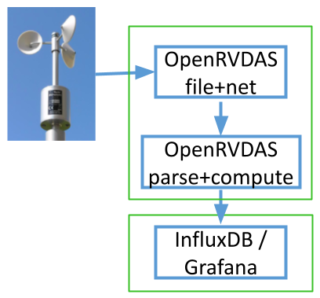
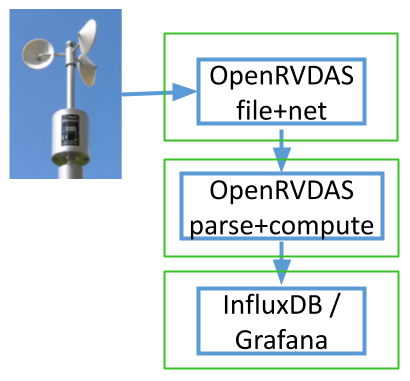

Where the data goes once a logger has it: the cached data server that
feeds everything live, the database that keeps history, the displays
people actually look at, mirroring it all ashore, and spreading the
load across machines when one stops being enough.

# The Cached Data Server

The cached data server (CDS) is the live hub of a running
installation: an in-memory cache of the recent values of every named
field, served to subscribers over websockets. The standard
installation runs one under supervisor on port **8766**, with a disk
cache that re-warms the memory cache across restarts and retention
limits (`--back_seconds`, `--max_records`) that keep it from growing
without bound. It is deliberately not storage — the logfiles and the
database are the records — but everything *live* flows through it:
console status, display widgets, derived-data loggers, and your own
subscribers.

Data gets in through a logger's `CachedDataWriter`, which forwards
each record as a websocket `publish` message (and buffers locally if
the connection drops). Data gets out through subscriptions, and one
piece of subscription vocabulary pays for itself everywhere, because
`CachedDataReader`, the display widgets and `listen --cached_data`
all share it — the per-field `seconds` value:

| `seconds` | First response contains |
|---|---|
| `0` | nothing — only values that arrive after subscribing |
| `-1` | the single most recent value, then new values as they arrive |
| `N` | up to N seconds of history, then new values as they arrive |

Subscriptions can also name fields with `*` wildcards, guarantee a
minimum number of historical records (`back_records`), slow the push
rate for low-bandwidth clients (`interval`), and ask for output
collated by timestamp (`format: record_list`) instead of the default
per-field lists.

For one-off queries — a shell script, an elog entry, anything that
doesn't want a websocket — the server also answers plain HTTP GET on
the same port:

```
curl http://localhost:8766/fields
curl http://localhost:8766/latest/S330CourseTrue,S330SpeedKt
```

Keep HTTP for occasional queries: the requests share the event loop
with every websocket client, so polling it hard delays data delivery
to everyone else. Anything continuous belongs on a subscription —
via `listen --cached_data` at the terminal, a `CachedDataReader` in a
logger, the `websockets` library from external Python, or a raw
browser `WebSocket`. The
[Cached Data Server]({{ "/cached_data_server/" | relative_url }})
page documents the full protocol, every client pattern, and the
server's flags.

# The Database

InfluxDB holds what the CDS doesn't: history. Each parsed field lands
as a time series, queryable by any tool that speaks Flux — Grafana
first among them. Installation and credentials were covered in
[section 3]({{ "/guide/installation/#influxdb-and-grafana" | relative_url }});
with `database/influxdb/settings.py` filled in, feeding the database
is one writer in a parsing logger:

```
writers:
- class: CachedDataWriter
  kwargs:
    data_server: localhost:8766
- class: InfluxDBWriter
  kwargs:
    bucket_name: openrvdas
    measurement_name: gyr1
```

`measurement_name` groups fields under the instrument they came from,
which keeps the database browsable; the sample cruise's `+influx`
modes do exactly this.

Two working tips. First, **generate Flux queries instead of writing
them**: build the query in InfluxDB's Data Explorer (pick fields, set
aggregation and range, Submit), then open its Script Editor and paste
the resulting Flux into a Grafana panel. Second, **InfluxDB tasks can
compute**: a task is a Flux query run on a schedule, writing its
results to another bucket — the mechanism behind both the
[feed-status monitoring]({{ "/guide/troubleshooting/#monitoring-feed-health" | relative_url }})
dashboard and the
[shoreside replication](#shoreside-replication) below.

InfluxDB is the recommended database, not the only one. A
`DatabaseWriter` with pluggable connectors covers PostgreSQL, MySQL,
MariaDB and MongoDB, and contributed writers exist for TimescaleDB,
Redis and CORIOLIX's PostgreSQL schema — or roll your own, as with
any writer.

# Displays

**Grafana dashboards** are the recommended display route: open
source, drag-and-drop, maintained by a large community that isn't us.
Once Grafana has the InfluxDB data source (section
[3]({{ "/guide/installation/#influxdb-and-grafana" | relative_url }})),
a dashboard is a set of panels, each backed by a Flux query — time
series, gauges, stats, maps. Like OpenRVDAS, Grafana takes plugins,
and purpose-built marine panels exist: the
[OpenRVDAS compass panel](https://github.com/OceanDataTools/grafana-compass-panel)
draws an integrated wind/compass rose from heading and wind fields:


**Grafana Live** covers the case InfluxDB can't: sub-second,
lag-free display. The `GrafanaLiveWriter` posts records straight to
Grafana's live-streaming endpoint — no database in the path, 20 Hz
and up — for the helm display or winch readout where a
store-then-query round trip is too slow. Streamed data isn't
retained, so loggers that feed Grafana Live usually also write to
InfluxDB for the record. Setup is on the
[Grafana Live]({{ "/grafana_live/" | relative_url }}) page.

**The built-in display widgets** predate all of this: Highcharts- and
D3-based dial, timeline, text and map widgets on web pages served by
the console under `/display/`, fed by direct websocket subscription
to the CDS — the tutorial's `nbp_dashboard.html` is one. They still
work, many vessels still run them, and the raw browser-websocket
route they use remains supported; but the widget framework itself is
deprecated, and new display work belongs in Grafana. Their
construction is documented on the legacy
[Displays and Widgets]({{ "/display_widgets/" | relative_url }})
page.

# Shoreside Replication

The goal: the same Grafana dashboards ashore that the ship uses at
sea, fed over a satellite link that comes and goes — with control
over which sensors shore is allowed to see. The pieces, all standard
InfluxDB machinery driven by OpenRVDAS modes:

1. **Tag at write time.** The parsing logger's `InfluxDBWriter` tags
   every measurement `restricted: 'no'` — except in a
   `+influx_restricted` variant of the config, which tags the
   sensitive instruments' measurements `restricted: 'yes'`. Which
   variant runs is just a cruise mode, so *restricting a sensor is a
   mode change in the console*, logged in the journal like any other.
2. **Filter and thin with a task.** An InfluxDB task runs every
   second, selects where `restricted == 'no'`, averages the numeric
   fields over the second, and writes the result to a
   `non_restricted` bucket with a short retention — a smaller,
   cleaner stream sized for the link.
3. **Replicate the bucket.** InfluxDB's native replication streams
   the `non_restricted` bucket to the shore server, queueing across
   outages and catching up when the link returns. Shore lags the
   ship; it never breaks.
4. **Point shore Grafana at the replica.** The dashboards are the
   same ones used aboard.

The complete worked configuration — modes, logger configs, the Flux
task and the replication commands — is in the
[InfluxDB Ship-to-Shore Replication]({{ "/cookbook/influxdb_shoreside_replication/" | relative_url }})
cookbook. (And the standing rule it opens with: replicate
non-restricted data only.)

# Distribution and Load Balancing

One machine runs most installations comfortably. The reason to use
two isn't usually capacity — it's blast radius. Acquisition is the
part whose failure loses data forever; parsing, databases and
dashboards can crash and catch up. So the classic split puts the
boring, load-bearing work on one box and everything interesting on
another:



The acquisition machine runs the front-line loggers — read,
timestamp, write raw to disk, broadcast — and nothing else. A second
machine reads the broadcast, and runs the parser, the derived-data
loggers, InfluxDB and Grafana. Science browsing dashboards, a runaway
Flux query, a Grafana upgrade: none of it can touch the box that's
holding the serial ports.

The relay between them is nothing new — the same mechanisms the
loggers already use, reaching across machines instead of across
processes:

* **UDP broadcast** is the lightweight default: the front-line
  loggers' `UDPWriter`s already broadcast to the subnet, and the
  second machine's `parse_data` logger just runs its `UDPReader`
  there instead. If a firewall sits between them, the data ports
  (6221–6226 by convention) must be open, per
  [section 3]({{ "/guide/installation/#standard-installation" | relative_url }}).
* **The cached data server** is the alternative when you want
  delivery guarantees or to cross subnets: writers point their
  `data_server` at `host:port` rather than `localhost`, and
  `CachedDataWriter` buffers through interruptions.

Under heavier load the same logic extends to three boxes — front-line
acquisition, parse-and-compute, and database/display — each failure
domain one step further from the instruments:



Where the pieces land is pure configuration: the cruise definition's
variables name the UDP destination, data server and InfluxDB URL, so
moving a tier to another machine is a variables change, not a
redesign. The shoreside replica above is the same idea stretched over
a satellite link — and a second OpenRVDAS installation elsewhere on
the ship can always subscribe to the first one's CDS, which is how
systems like CORIOLIX build on OpenRVDAS without touching its
loggers.
