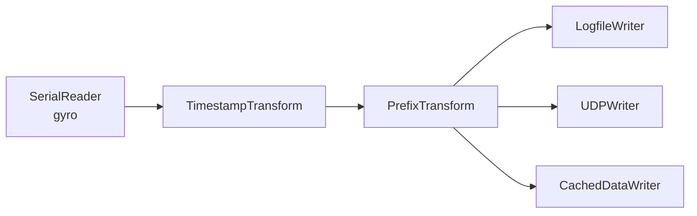
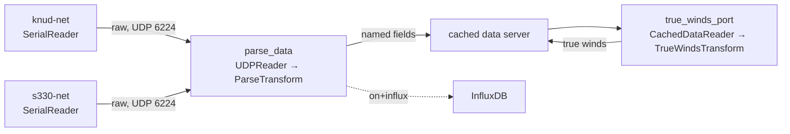
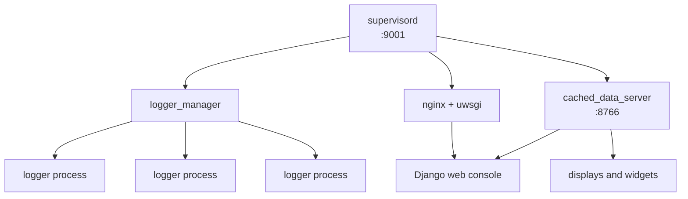

TITLE
Keeping OpenRVDAS Running

EYEBROW
Tutorial deck · speaker script

STANDFIRST
A slide-by-slide script for teaching OpenRVDAS to the marine technicians who
will operate it, keep it alive, and debug it at 0300 when a feed goes quiet.
Each entry gives the text that belongs on the slide and the words to say over it.

FACTS
Audience: Marine techs
Run time: ~60 min
Format: Talk + demo

INTRO

**How to use this document.** Every slide has two parts. *On the slide*
is the text and code that should actually be projected. Keep it short: it is
scanned, not read. *What you say* is the spoken version, written out so anyone
on the team can deliver this deck cold.

Tags mark what kind of slide it is: {{demo}} means stop talking and
show it live, {{gotcha}} is a failure the room will hit within a
week, {{drill}} is hands-on-keyboards, and
{{ref}} is a slide people will photograph.

The session runs an hour: about 45 minutes on OpenRVDAS itself, plus 15 minutes
on where it sits relative to CORIOLIX, InfluxDB and Grafana. A one-hour
CORIOLIX talk follows, so this deck sets expectations for that talk and
leaves CORIOLIX itself to them.

Commands use the short names the installer puts in the OpenRVDAS virtual
environment (`listen`, `validate_config`, `simulate_data`). Slide 8 says how to
fall back to the full script paths. Paths, ports and commands are the defaults
from a standard installation on a machine named `openrvdas` with the OpenRVDAS
user `rvdas`, running the NBP1406 sample cruise. Substitute your ship's values
before delivery, and run through the demos once on the actual system. A demo
that fails live is worth more than one that is skipped, but only if you know
why it failed.

# Why you are here
Five slides, five minutes. Set the frame: this is not a developer course, it is a course for the people who get called when data stops. Then draw the map the rest of the hour hangs on.

## Title slide  {ref}

ON SLIDE

**Working Onboard with OpenRVDAS** \
Understanding what's going on, keeping it running, and poking at it when it needs it

Your name · ship or institution · date

SAY

Welcome. Over the next hour we are going to take OpenRVDAS apart and put it
back together, from a single record coming off a serial port all the way up to
the whole ship's logging system, and then look at what sits on top of it.

I am not going to teach you to write Python. I am going to teach you to read a
configuration, know which process is responsible for what, and work out —
quickly, under pressure — which link in the chain has broken, and whether that
link is even part of OpenRVDAS.

## What you will be able to do by the end

ON SLIDE

- Understand the general organization of OpenRVDAS
- Open up the OpenRVDAS console and know what you're looking at
- Look at logger configurations and understand what they're doing (or should be doing)
- Troubleshoot when they're not doing what they should
- Tell whether a problem is in OpenRVDAS or downstream of it
- Bonus: understand the system well enough to install it on a new ship, and to write and configure new loggers for your ship

SAY

The first four are the job, and three of them are about the most common call you
will get: it was working yesterday, and today it is not. The fifth is the one
that saves you the most time. Half the "OpenRVDAS is down" reports you get will
turn out to be a dashboard, a database or another system entirely, and the
quickest fix is knowing that within the first two minutes.

The bonus is there for the people who want it. Most OpenRVDAS problems are
diagnosed in under five minutes by someone who knows where to look, and take
days for someone who does not. Installing and extending it is the same
knowledge, taken one step further.

## Where OpenRVDAS sits  {ref}

ON SLIDE

```svg
<svg viewBox="0 0 720 396" role="img" aria-label="Instruments feed OpenRVDAS. CORIOLIX sits beside OpenRVDAS and writes its configuration. OpenRVDAS writes to files and the network, to databases such as InfluxDB that Grafana reads, and through CORIOLIXWriter to the CX database backend, which CX reads." font-family="-apple-system, BlinkMacSystemFont, 'Segoe UI', Arial, sans-serif" fill="none" stroke="currentColor" stroke-width="1.5">
  <defs>
    <marker id="where-arrow" viewBox="0 0 10 10" refX="9" refY="5" markerWidth="7" markerHeight="7" orient="auto-start-reverse">
      <path d="M0,0 L10,5 L0,10 z" fill="currentColor" stroke="none"/>
    </marker>
  </defs>
  <!-- row 1 -->
  <rect x="140" y="16" width="180" height="40" rx="4"/>
  <text x="230" y="41" text-anchor="middle" font-size="13" fill="currentColor" stroke="none">Instruments</text>
  <!-- row 2 -->
  <rect x="120" y="100" width="220" height="60" rx="4" style="stroke: var(--accent); stroke-width: 2.5"/>
  <text x="230" y="126" text-anchor="middle" font-size="14" font-weight="700" fill="currentColor" stroke="none">OpenRVDAS</text>
  <text x="230" y="146" text-anchor="middle" font-size="12" fill="currentColor" stroke="none">read · process · write</text>
  <rect x="480" y="100" width="220" height="60" rx="4"/>
  <text x="590" y="126" text-anchor="middle" font-size="14" font-weight="700" fill="currentColor" stroke="none">CORIOLIX (CX)</text>
  <text x="590" y="146" text-anchor="middle" font-size="12" fill="currentColor" stroke="none">keeps OpenRVDAS running</text>
  <!-- row 3 -->
  <rect x="20" y="240" width="180" height="50" rx="4"/>
  <text x="110" y="261" text-anchor="middle" font-size="12" fill="currentColor" stroke="none">Files and network</text>
  <text x="110" y="278" text-anchor="middle" font-size="12" fill="currentColor" stroke="none">(UDP)</text>
  <rect x="240" y="240" width="180" height="50" rx="4"/>
  <text x="330" y="261" text-anchor="middle" font-size="12" fill="currentColor" stroke="none">Databases</text>
  <text x="330" y="278" text-anchor="middle" font-size="12" fill="currentColor" stroke="none">such as InfluxDB</text>
  <rect x="500" y="240" width="180" height="50" rx="4"/>
  <text x="590" y="270" text-anchor="middle" font-size="12" fill="currentColor" stroke="none">CX database backend</text>
  <!-- row 4 -->
  <rect x="240" y="340" width="180" height="40" rx="4"/>
  <text x="330" y="365" text-anchor="middle" font-size="12" fill="currentColor" stroke="none">Grafana dashboards</text>
  <!-- arrows -->
  <line x1="230" y1="56" x2="230" y2="98" marker-end="url(#where-arrow)"/>
  <line x1="480" y1="130" x2="342" y2="130" marker-end="url(#where-arrow)"/>
  <text x="411" y="121" text-anchor="middle" font-size="11" fill="currentColor" stroke="none">writes configuration</text>
  <line x1="170" y1="160" x2="115" y2="238" marker-end="url(#where-arrow)"/>
  <line x1="250" y1="160" x2="320" y2="238" marker-end="url(#where-arrow)"/>
  <line x1="320" y1="160" x2="530" y2="238" marker-end="url(#where-arrow)"/>
  <text x="428" y="182" text-anchor="middle" font-size="11" fill="currentColor" stroke="none">CORIOLIXWriter</text>
  <line x1="640" y1="240" x2="640" y2="162" marker-end="url(#where-arrow)"/>
  <text x="648" y="205" font-size="11" fill="currentColor" stroke="none">reads</text>
  <line x1="330" y1="290" x2="330" y2="338" marker-end="url(#where-arrow)"/>
  <text x="338" y="318" font-size="11" fill="currentColor" stroke="none">reads</text>
</svg>
```

- OpenRVDAS processes the data and writes it to files, the network, and databases such as InfluxDB
- On CX ships it also writes to CX's database backend, using `CORIOLIXWriter`
- Grafana reads from InfluxDB (or another suitable database) to produce dashboards
- CORIOLIX reads from its own backend, and also wraps around OpenRVDAS itself

SAY

Here is the map for the whole hour. Data comes off the instruments into
OpenRVDAS, which processes it and writes it out: to files on disk, to the
network, and into databases. Two things feed off those databases. Grafana draws
dashboards from InfluxDB. And on ships that run it, CORIOLIX reads from its own
database, which OpenRVDAS feeds through a writer called `CORIOLIXWriter`.

Under the instruments, OpenRVDAS and CORIOLIX sit side by side: CX keeps
OpenRVDAS running and writes its configuration, and everything below them is
downstream. This hour is the OpenRVDAS
box, and the handoff to what sits below it. Keep
this picture in mind. Every time I ask "which side of the line is it on?" later,
this is the line I mean.

## OpenRVDAS and CORIOLIX

ON SLIDE

Some ships run **CORIOLIX** (CX for short), a system that sits on top of
OpenRVDAS. Among other things, it:

- keeps OpenRVDAS running
- manages its configurations
- processes and routes its output to create off-ship "datapresence"

OpenRVDAS hands data to CX through a `CORIOLIXWriter`, which writes to whatever
database backend CX is installed with.

*The next hour covers CX in depth.*

SAY

If your ship runs CORIOLIX — CX for short — you will meet OpenRVDAS through it.
CX keeps OpenRVDAS running, manages its configurations, and takes its output
and routes it off the ship. The data gets to CX through one more writer,
`CORIOLIXWriter`, which writes to whatever database CX was installed with.

Two practical consequences. First, on a CX ship some of what I do by hand today
— loading configurations, changing modes — may be done through CX instead. The
OpenRVDAS pieces underneath are the same: the same loggers, the same error
files, the same `listen` command. Second, the CORIOLIX team has the next hour,
so hold your CX questions for them. They will be able to answer them properly.

NOTE: check this slide's wording with the CORIOLIX presenters before delivery, so the two talks describe the relationship the same way.

## The whole system in one sentence

ON SLIDE

**OpenRVDAS reads data from sensors, processes/transforms it as needed, then writes it to one or more destinations using small, simple components that you "snap together" using a configuration file.**

Everything else — the web console, the servers — exists to manage that one
idea at scale.

SAY

Hold onto this sentence, because every OpenRVDAS screen you will see today is a
view of it. A record comes in from a gyro or a GPS or a weather mast. It may get
a timestamp added, or get parsed into named fields. Then it goes somewhere: a
file, a network port, a database, a display.

When something breaks, it breaks at one of those steps. The whole troubleshooting
method we will build today is just: follow the record, find the step where it
stops.

# Readers, transforms, writers
Three slides, eight minutes. The core mental model. Everything after this is configuration and plumbing around these three parts, so do not rush it.

## Three components

ON SLIDE

- **Readers** read a record from somewhere: `SerialReader`, `UDPReader`, `LogfileReader`
- **Transforms** turn a record into another record: `TimestampTransform`, `PrefixTransform`, `ParseTransform`
- **Writers** write a record somewhere: `LogfileWriter`, `UDPWriter`, `CachedDataWriter`, `InfluxDBWriter`

That is the entire vocabulary.

SAY

OpenRVDAS is built out of three kinds of component, and the documentation
describes them as being "snapped together" — which is exactly right, and worth
taking literally. They have deliberately simple jobs so they can be recombined
without anyone writing new code.

A reader knows how to get data out of one kind of source. `SerialReader` is the
one you will meet most, because most shipboard instruments still talk over a
port and a baud rate. `LogfileReader` means you can replay yesterday's data
through a new configuration to test it — no instrument required.

A transform sits in the middle and changes the record: stamps the time it
arrived, labels which instrument it came from, or parses the raw string into
named fields. A writer puts data into one kind of destination. Notice
`InfluxDBWriter` at the end of that list. It is just another writer, and we will
come back to it when we talk about Grafana.

## Snapping them together

ON SLIDE

Readers run **in parallel** → transforms apply **in series**
→ writers run **in parallel**.



SAY

Here is the shape of every logger in the system. Readers are called in parallel,
each in its own thread. Whatever they produce is passed through the transforms
one after another, in the order you listed them. The result is handed to all the
writers at once.

Two things to take from this. Order matters in the middle and nowhere else: if
you prefix before you timestamp, the label lands in a different position, which
can quietly break a parser downstream. And one record goes to several writers.
So "the data is gone" usually means one writer's destination is unhappy, not
that the instrument stopped. The file may be healthy while the display is dark.

## From flags to a file  {demo}

ON SLIDE

One command, one logger, straight to your screen:

```
listen --serial port=/tmp/tty_s330,baudrate=9600 --write_file -
```

`-` means the screen (stdout). Shortcut: with no writer at all, `listen` writes to the screen anyway, so on the command line you can leave `--write_file -` off.

Add transforms and destinations:

```
listen --serial port=/tmp/tty_s330,baudrate=9600 \
  --transform_timestamp \
  --transform_prefix s330 \
  --write_logfile /var/data/openrvdas/demo/s330 \
  --write_udp 6224
```

The same logger, written down:

```
listen s330.yaml
```

`listen` is a shortcut for `logger/listener/listen.py`. Run `source /opt/openrvdas/venv/bin/activate` first. If it isn't found, use the full path from `/opt/openrvdas`.

SAY

Let me show you the smallest possible logger. `listen` is the command that
assembles readers, transforms and writers and runs them. Here it is reading one
of the simulated serial ports on the training machine, and `--write_file` with a
dash tells it to write to the screen.

When you are working at the command line, you can save yourself the typing: if
you don't name any writer at all, `listen` writes to the screen anyway. You will
see me use that shortcut later, for example `listen --udp 6224` on its own.

Watch what happens when I add the timestamp and prefix: same data, now labelled.
Now I add a file and a network port as destinations, and the screen goes quiet.
Once you name writers, the data goes only where you said. It's in the file, and
it's on UDP port 6224.

Now the same logger from a file. `s330.yaml` says exactly what those flags said,
and `listen` runs it the same way. That is the whole idea of a configuration
file: flags, written down. The next section teaches you to read one. And keep
`listen` in mind — it is the single most useful troubleshooting tool you have,
and we come back to it at the end.

NOTE: one-time setup on the training machine: `sudo mkdir -p /var/data/openrvdas` and `sudo chown rvdas:rvdas /var/data/openrvdas`, then load a copy of the compact test/NBP1406/NBP1406_cruise.yaml with `file_root: /var/data/openrvdas`. Don't use NBP1406_cruise_full.yaml, which writes `/var/tmp/log` into every config.

NOTE: before this slide, put the cruise in the 'off' mode so no managed logger holds /tmp/tty_s330, and make sure the simulator is running (`simulate_data --config test/NBP1406/simulate_NBP1406.yaml` in another window). Have `s330.yaml` ready with the same reader, transforms and writers as the second command. The `listen` shortcut and the other short commands are installed with the OpenRVDAS package; on an older install, run `logger/listener/listen.py` from `/opt/openrvdas` with the same arguments.

# Enough YAML to be dangerous
Three slides, five minutes. Not a language course — just the rules that prevent the errors people actually make at two in the morning, shown on the file the room just watched run.

## Configs are files, written in YAML

ON SLIDE

```
readers:
- class: SerialReader
  kwargs:
    port: /tmp/tty_s330
    baudrate: 9600
transforms:
- class: TimestampTransform
- class: PrefixTransform
  kwargs:
    prefix: s330
writers:
- class: LogfileWriter
  kwargs:
    filebase: /var/data/openrvdas/demo/s330
- class: UDPWriter
  kwargs:
    port: 6224
```

- **Key-value pairs** — `baudrate: 9600`, with a space after the colon
- **Lists** — a dash and a space: `- class: ...`
- A set of key-value pairs is a *mapping*, a *dictionary* or a *dict* — same thing, three names

SAY

This is `s330.yaml`, the file from the demo. Everything I did with flags is
written down here, so the configuration that worked last cruise is still there,
exactly, at the start of this one. It can be reviewed, copied and diffed.

YAML is only two things for our purposes. Keys with values: `baudrate: 9600`.
And lists, where each item starts with a dash. Everything else is those two
nested inside each other. Here, `readers` is a key whose value is a list, and
each item in that list is a set of key-value pairs. You will hear that called a
mapping, a dictionary or a dict depending on who is talking; they all mean the
same thing.

## Indentation is structure  {gotcha}

ON SLIDE

```
writers:
- class: UDPWriter
  kwargs:
    port: 6224
```

- Indented under a key means **belongs to** that key
- **Spaces only.** A tab is illegal and the error will not say so clearly
- Two spaces per level; things at the same level line up exactly
- A setting under the wrong parent does not error — it attaches to the wrong thing

SAY

There are no braces or brackets marking where a section begins and ends.
Indentation does that job, so whitespace is not cosmetic — it is the structure.
`port: 6224` belongs to `kwargs`, which belongs to this `UDPWriter`, which is
one item in the `writers` list. Move `port` two spaces left and it no longer
belongs to `kwargs`.

Two failure modes. First, tabs: your editor may insert one when you press Tab,
and YAML rejects tabs in indentation. Set your editor to insert spaces, today, on
every machine you use. Second, and worse, a setting indented under the wrong
parent often does not error at all. It attaches to the wrong component, and you
get a logger that runs and ignores you.

## Validate, don't guess  {demo}

ON SLIDE

```
validate_config s330.yaml
```

Run it before you load anything into the live system.

SAY

OpenRVDAS ships a validator, and it checks more than syntax — it checks whether
the structure makes sense as an OpenRVDAS configuration. It takes two seconds,
and it will save you from loading a broken cruise definition in the middle of a
transit.

Let me break this file deliberately — I will put a tab in one line — and show
you what the error looks like, because recognising that message is worth more
than any explanation of it.

NOTE: keep a known-good copy of s330.yaml to restore after the demo.

# Defining one logger
Five slides, six minutes. Now we put the two previous sections together: the component model, written down in YAML.

## The anatomy of a logger config

ON SLIDE

Three top-level keys, in pipeline order:

```
readers:
  ...
transforms:
  ...
writers:
  ...
```

Read it top to bottom and you are reading the dataflow.

SAY

Every logger configuration has the same three keys, and they appear in the order
the data travels. You have already seen this in `s330.yaml`. That order is
deliberate: the file is meant to be read as a description of the pipeline, not
as code.

So when you open an unfamiliar config, you already know its shape. Where does the
data come from, what happens to it, where does it go. Three questions, three keys.

## Every component: class plus kwargs

ON SLIDE

```
- class: SerialReader
  kwargs:
    port: /tmp/tty_knud
    baudrate: 19200
```

- `class` — which component
- `kwargs` — the arguments it takes
- No `kwargs` needed when the defaults are fine

SAY

Every component in every config follows this one pattern: name the class, then
give it its arguments under `kwargs`. "Kwargs" is just the Python word for named
arguments — you can read it as "settings."

The valuable consequence: when you want to know what settings a component
accepts, there is a definitive answer in the API reference on the documentation
site, generated from the source itself. Look up the class, read its arguments. No
guessing, and no waiting for someone to answer an email.

## A real configuration, line by line

ON SLIDE

```
knud-net:
  readers:
  - class: SerialReader
    kwargs:
      port: /tmp/tty_knud
      baudrate: 19200
  transforms:
  - class: TimestampTransform
  - class: PrefixTransform
    kwargs:
      prefix: knud
  writers:
  - class: UDPWriter
    kwargs:
      port: 6224
      destination: 255.255.255.255
```

SAY

Read this one out loud with me. Take the Knudsen's serial port at 19200 baud.
Stamp each record with the time it arrived. Label it "knud" so we know where it
came from once it is out on the network. Broadcast it on UDP port 6224 to
everyone on the subnet — that is what the all-255s destination means.

That is the whole logger. Notice the name at the top — `knud-net`. The "-net" is
a convention, not a rule: it tells you this configuration sends to the network
but does not write to disk. You will see names like `knud-off` and
`knud-net+file` alongside it.

## One instrument, several configurations

ON SLIDE

- `knud-off` — do nothing (an empty config, `{}`)
- `knud-net` — read and broadcast
- `knud-net+file` — read, broadcast, and write to disk

Same instrument. Different jobs at different times.

SAY

A single instrument usually has several configurations defined for it, and
exactly one of them is active at any moment. In port you may want the Knudsen
off entirely. Underway you want it logging to disk and feeding the network.

"Off" is a real configuration — an empty one. That is a design decision worth
understanding: the system always knows what state a logger is supposed to be in,
even when that state is doing nothing. There is no gap between "off" and
"unknown."

## Read a config like a troubleshooter  {drill}

ON SLIDE

Given any config, answer in ten seconds:

- What device or port does this depend on?
- What would I see if the reader worked but the writer did not?
- Which destination would go quiet first?

SAY

Let us practise. I will put three configurations up in turn and I want the room
to answer those questions — not me. This is the habit I am trying to build: you
look at a config and you immediately see its dependencies and its failure modes.

The one that catches people is the last question. A logger writing to both a
file and a display can lose the display while the file keeps growing, and the
person who calls you will describe that as "the logger is down." It is not. One
writer is.

NOTE: two minutes. Good candidates from the sample cruise: knud-net+file (file plus network), parse_data-on+influx (reads UDP, writes to the cached data server and InfluxDB), and true_winds_port-on (reads from the cached data server and writes back to it).

# Defining a whole cruise
Six slides, seven minutes. Scaling from one logger to a ship, and the operational concept that matters most to the people on watch: modes.

## The cruise definition  {ref}

ON SLIDE

One file describes the whole ship. Five top-level keys:

```
cruise:
  id: NBP1406
  start: '2019-07-01'
  end: '2019-12-31'
loggers:       # what loggers exist, and their config names
configs:       # the actual configuration definitions
modes:         # which configs run together
default_mode: 'off'
```

Optional: `includes`, `variables`.

SAY

A working ship has twenty or more instruments, each with three or four
configurations, and nobody wants to start them by hand in the right order. The
cruise definition file is the single document that describes the whole system.
It is the file you will be handed when you join a ship, the file you will edit
when an instrument is added, and the file you will send to someone when you need
help. Know where it lives on your vessel before you need it.

Five keys. Photograph this slide. `cruise` is metadata — the cruise ID shows at
the top of the web console. `loggers` declares what exists. `configs` holds the
real definitions. `modes` groups them. `default_mode` says what to start in.
Keep an eye on those quotes around the dates and around 'off'; we will come
back to them in two slides.

## loggers: a convenient fiction

ON SLIDE

```
loggers:
  knud:
    configs:
    - knud-off
    - knud-net
    - knud-net+file
configs:
  knud-off: {}
  knud-net:
    readers: ...
```

A "logger" is just a named group of configurations. Any one of them runs straight from the cruise file:

```
listen cruise.yaml:knud-net
```

SAY

Here is a subtlety that will save you confusion later. Strictly speaking there
is no such object as a logger in OpenRVDAS. What exists are configurations,
defined under `configs`, exactly as we read them in the last section. A "logger"
is a name we group them under — everything responsible for the Knudsen's data
stream.

Why care? Because when you look at running processes on the machine, you will
not find a process called "knud." You will find a process running whichever
configuration is currently active for knud. And that last line is worth
remembering: `listen`, a cruise file, a colon and a config name runs that one
configuration by itself. We will use exactly that when we troubleshoot.

## Loggers that feed loggers

ON SLIDE



- Instrument loggers read their serial ports and broadcast raw records on UDP 6224
- `parse_data` reads that UDP stream, parses every instrument's records into named fields, and writes them to the cached data server (and InfluxDB)
- `true_winds_port` reads from the cached data server, computes true winds, and writes them back
- One logger's writer is another logger's reader

SAY

Not every logger talks to an instrument. On the training cruise, the instrument
loggers do as little as possible: read the port, stamp and label each record,
broadcast it on UDP port 6224, and, when writing, keep a raw file. A separate
logger, `parse_data`, listens on 6224, parses everything it hears into named
fields, and hands the result to the cached data server. A third kind of logger,
`true_winds_port`, reads course, heading and wind from the cached data server,
computes true winds, and writes them back.

It is the same three-part logger every time; only the reader changes. That is
why the network readers matter: one logger's writer is another logger's reader.

The consequence for troubleshooting is worth saying out loud. If `parse_data`
is off or failing, every instrument logger stays green and every raw file keeps
growing, but every display and every Grafana panel goes blank at once. When
everything downstream fails together and the raw data is fine, look at the
logger in the middle.

NOTE: on the training cruise (compact NBP1406_cruise.yaml) the parsing logger is `parse_data`, with configs parse_data-off, parse_data-on and parse_data-on+influx. In NBP1406_cruise_full.yaml the equivalent logger is called net_reader.

## modes: the operational switch

ON SLIDE

```
modes:
  'off':
    knud: knud-off
    s330: s330-off
  port:
    knud: knud-off
    s330: s330-net
  underway:
    knud: knud-net+file
    s330: s330-net+file
```

SAY

This is the slide the watch officers care about. A mode is a mapping from every
logger to the configuration it should be in during that phase of the cruise. In
port, the GPS is running but the Knudsen is off — you do not ping the harbour.
Underway, everything logs to disk.

One mode change puts the entire ship into a known, consistent state. That is the
whole point: nobody has to remember which of twenty instruments to start when
you clear the breakwater.

NOTE: the sample cruise names its modes 'off', no_write, write, no_write+influx and write+influx; port and underway here are illustrative.

## The values that bite  {gotcha}

ON SLIDE

```
'off': {}            # 'off' is a YAML keyword — quote it
start: '2019-07-01'  # unquoted, this becomes a date object
port: 6224           # a number
flush: true          # a boolean, not the word "true"
prefix: knud         # plain text, no quotes needed
```

If a value is meant to be text but looks like something else, quote it.

SAY

You have now seen two sets of quotes that look unnecessary: around 'off' in the
modes, and around the cruise dates. Here is why. YAML tries to be helpful about
types, and occasionally that helpfulness is wrong. Bare, `off` reads as a
boolean false. Your "off" mode is a name, not a false, so it gets quotes
everywhere it appears as a mode name.

Dates are the other one: quote them or they stop being text. The general rule:
if a value is meant to be read as text but looks like something else, put quotes
around it. Single quotes are the safe default for paths and regular expressions,
since they take the contents literally.

## What a mode change actually does

ON SLIDE

1. You pick a mode in the console
2. The logger manager looks up each logger's config for that mode
3. It stops processes that should not be running
4. It starts processes that should be, one per active configuration
5. It records the new state and keeps watching

SAY

Worth being concrete, because this explains what you see when it goes wrong. A
mode change is not a setting — it is a batch of process stops and starts. Each
active configuration runs as its own process.

So after a mode change, give it a few seconds. Loggers go green as their
processes come up. If one stays red or flickers, that logger's process is failing
to start or dying immediately. That is what you are watching when a logger goes
red, and the troubleshooting section shows you exactly where its error message is
waiting for you.

# The servers that keep it running
Four slides, seven minutes. Who starts what, who watches whom, and where the web console fits.

## The moving parts  {ref}

ON SLIDE



Displays blank but files growing? Suspect the cached data server or the parsing logger, not the instrument loggers.

SAY

This is the whole running system on one slide. At the top, supervisord — the
thing that starts everything else and restarts it if it dies. Under it, three
services: the logger manager, the cached data server, and the web stack.

The logger manager spawns the individual logger processes. The cached data
server holds recent data in memory and serves it to the console and the built-in
displays. It is short-term memory, not your archive, so if displays are blank but
the data files are growing, look there, or at the parsing logger that feeds it,
rather than at the instrument loggers.

If your ship runs InfluxDB and Grafana under supervisord too, you will see them in
the same status listing. They are still separate systems, and we will get to
them in the next section.

## supervisord: the thing that starts things  {demo}

ON SLIDE

Web: `http://openrvdas:9001`  ·  Command line: `supervisorctl`

```
supervisor> status
openrvdas:cached_data_server   RUNNING   pid 14124, uptime 0:00:34
openrvdas:logger_manager       RUNNING   pid 14123, uptime 0:00:34
web:nginx                      RUNNING   pid 13684, uptime 0:01:22
web:uwsgi                      RUNNING   pid 13685, uptime 0:01:22

supervisor> restart openrvdas:cached_data_server
```

SAY

Supervisord is a Linux service manager, and in a default OpenRVDAS installation
it owns the logging system's servers. Its console is on port 9001, and this is
genuinely the first place to look when something is wrong at the system level:
everything either says RUNNING or it does not.

Its configuration lives under `/etc/supervisor/conf.d/` on Ubuntu or
`/etc/supervisord.d/` on CentOS and RedHat. That file is where you would see
exactly which flags each server was started with — useful when the behaviour does
not match what you expected.

NOTE: restart one service live so the room sees it go down and come back. Choose the cached data server, not the logger manager.

## logger_manager: the conductor

ON SLIDE

- Loads the cruise definition and remembers it in a database
- Starts and stops one process per active logger configuration
- Watches those processes and restarts failures
- Publishes status the web console reads

```
server/logger_manager.py --database django --no-console \
    --data_server_websocket :8766 -v
```

SAY

The logger manager is the process that actually runs your cruise. It reads the
cruise definition, decides what should be running based on the current mode, and
spawns those processes. Then it keeps watching them and restarts the ones that
die.

That auto-restart is a double-edged thing worth flagging now. A logger whose
instrument is unplugged may fail, restart, fail, restart. In the console that
looks like flickering rather than a clean failure — and it is a strong hint that
the logger's own error file will tell you why. The troubleshooting section shows
you where to find it.

## The web console  {demo}

ON SLIDE

- Served by nginx and uwsgi, backed by Django — `http://openrvdas`
- Log in as the OpenRVDAS user to make changes
- Load a cruise definition, change mode, change any single logger
- Click a logger to see its recent stderr *and* its expanded config

SAY

This is where most of your day-to-day work happens. Loggers appear as buttons
showing their current configuration, green when running. Click one and you get a
dropdown to change its configuration — plus, and this is the part people miss,
that logger's recent error output and the actual expanded definition it is
running.

That means the console alone answers "what is it doing" and "what went wrong" for
a single logger, without touching a terminal. One caveat: without the cached data
server, you can still start and stop loggers, but you will not get live feedback
on whether it worked. Green depends on that link.

# Downstream: InfluxDB and Grafana
Four slides, eight minutes. What happens to the data after an OpenRVDAS writer lets go of it, and how to tell where OpenRVDAS stops.

## InfluxDB: a time-series store

ON SLIDE

- In many installations, OpenRVDAS writes to an external time-series database with `InfluxDBWriter`
- `InfluxDBWriter` is an ordinary writer at the end of an ordinary logger
- Default bucket `openrvdas`; each record's data_id becomes its measurement
- Web UI on `:8086`, with a built-in Data Explorer

InfluxDB doesn't collect anything itself. It stores what a writer sends it.

SAY

InfluxDB is a database designed for exactly what we produce: values with
timestamps, lots of them. OpenRVDAS gets data into it the same way it gets data
anywhere else — with a writer. On the training cruise it is the `parse_data`
logger from earlier, in its `on+influx` config: it listens on UDP port 6224,
parses everything it hears into named fields, and hands the result to two
writers, the cached data server and `InfluxDBWriter`.

The point to hold onto: InfluxDB does not reach out and collect anything. If a
value is not in InfluxDB, either no logger sent it, or the writer that tried to
send it failed. And the reverse is worth saying clearly: if InfluxDB or Grafana is
down, your data is still being logged to disk. The archive does not depend on the
dashboard.

## Grafana: dashboards and QC

ON SLIDE

- Queries InfluxDB to draw panels
- Thresholds and alerts
- QC workflows on the stored data
- Web UI on `:3000`

`GrafanaLiveWriter` can also stream straight to a live Grafana panel, with no database in between. Know which path your dashboards use.

SAY

Grafana is the thing people actually look at. It asks InfluxDB for data and
draws it — time series, gauges, maps — and it can set thresholds, raise alerts,
and support more involved QC workflows on top of the stored data. None of that is
OpenRVDAS. OpenRVDAS put the data in the database; Grafana decides what to ask
for and how to show it.

There is one wrinkle. OpenRVDAS also has a `GrafanaLiveWriter` that streams
straight to a Grafana panel without going through a database, for high-rate live
displays. If your ship uses it, those panels have a different path to check, so
find out which kind yours are before you need to know.

## Follow one field up the stack  {demo}

ON SLIDE

`S330SpeedKt`, three places:

1. On the network, from a second machine: `listen --udp 6224` shows the raw s330 record
2. In InfluxDB: Data Explorer, bucket `openrvdas`, last 15 minutes
3. In Grafana: the panel that plots ship's speed

Each layer can be checked on its own.

SAY

Let me follow one value, ship's speed from the s330 GPS, all the way up. First,
on the network, straight out of the s330 logger: `listen` on port 6224, and there
is the raw sentence. Second, in InfluxDB's Data Explorer: after `parse_data` has
parsed it, there is `S330SpeedKt` as a field with recent values. Third, the
Grafana panel that plots it.

The reason to do this now is that it is exactly the troubleshooting method for
the downstream half. Each of those three places can be checked on its own, and
whichever one is the first to go empty tells you which system owns the problem.

NOTE: needs a training machine with InfluxDB, Grafana and parse_data running in its on+influx config (the no_write+influx or write+influx mode). Run step 1 from a second machine on the same subnet: on the training machine itself, parse_data already holds UDP 6224, so `listen --udp 6224` there fails with "Address already in use". Without a second machine, use write+influx and show the raw s330 data file with `tail -f` instead.

## Where OpenRVDAS stops, and where to get help  {ref}

ON SLIDE

- The boundary is inside the writer. If `InfluxDBWriter` can't connect or its token is rejected, the error is in *that OpenRVDAS logger's stderr*, though the fix is on the InfluxDB side
- Anything after the data is stored (queries, panels, QC rules, alerts) belongs to Grafana
- The same holds on CX ships: `CORIOLIXWriter` errors are in its logger's stderr; once the data is in CX's backend, it belongs to CX

| Layer | Where to get help |
| --- | --- |
| OpenRVDAS → InfluxDB/Grafana | OpenRVDAS docs: "Grafana/InfluxDB-based Displays", "Grafana Live Setup" |
| InfluxDB | InfluxData documentation |
| Grafana | Grafana documentation and community forum |
| CX | The CORIOLIX team — next talk |
| Your dashboards | *who owns them on this ship* |

SAY

Here is the line. The last piece of OpenRVDAS in the chain is the writer. If
`InfluxDBWriter` cannot reach the database, or its token has changed, that error
shows up in the error file of the OpenRVDAS logger running it — `parse_data` on
our training cruise — even though the fix is in InfluxDB. That trips people up, so
remember it. Everything after the data is stored — the queries, the panels, the
QC rules, the alerts — belongs to Grafana.

CX works the same way. `CORIOLIXWriter` runs inside an OpenRVDAS logger, so its
errors are in that logger's error file. Once the data is in CX's backend, it is
CX's, and that is the next talk.

Know where to take each kind of question. Installing and configuring InfluxDB and
Grafana is covered on the OpenRVDAS documentation site and in the vendors' own
documentation. And fill in the last row before you leave today: who on your ship
owns the dashboards.

NOTE: for install questions, point people to the docs page and the vendors' instructions, not utils/install_influxdb.sh, which is deprecated.

# Running it, and fixing it
Four slides, eleven minutes. The reason everyone is in the room: first decide which system you are in, then work down the OpenRVDAS side one step at a time.

## OpenRVDAS or downstream?

ON SLIDE

Before you debug, find out which system you are in. Walk up the stack:

1. **Is OpenRVDAS producing it?** Logger green? Does data show up in `tail -f`, or in `listen --udp` run from another machine? If not, it's OpenRVDAS: go to the triage ladder
2. **Is it in InfluxDB?** Data Explorer, last 15 minutes. If not, read the stderr of the logger with the `InfluxDBWriter`: connection, token, bucket
3. **Is the panel asking for it correctly?** Time range, bucket, field name, data source. If the data is in InfluxDB but not on the panel, it's a Grafana dashboard problem, not OpenRVDAS

On a CX ship, the CX path works the same way: data flowing but not in CX? Read the stderr of the logger with the `CORIOLIXWriter`. If it's clean, it's a CX question.

| Symptom | Where the problem is |
| --- | --- |
| Grafana says "No data", but InfluxDB has it | The dashboard |
| InfluxDB empty, logger green, stderr shows 401 | The InfluxDB token |
| Built-in displays blank, Grafana fine | The cached data server |
| CX missing data, `CORIOLIXWriter` logger green and stderr clean | CX |
| Everything blank, including the data files | OpenRVDAS, reader side |

SAY

Before you touch anything, work out which system you are in. Walk up the picture
from the start of the talk, one question at a time. Is OpenRVDAS producing the
data? If not, it's ours, and the next two slides are for you. Is it in InfluxDB?
If not, the logger with the InfluxDB writer will say why. Is the panel asking for
it correctly? If the data is in the database and not on the screen, that is a
dashboard problem, and no amount of restarting loggers will fix it.

The most common version of this I see is a Grafana time range. Someone set a
panel to show last Tuesday, and it has been reported as "OpenRVDAS stopped
logging." Two minutes on these questions saves twenty minutes on a healthy
logger.

## Follow the record  {ref}

ON SLIDE

**Instrument → port → reader → transforms → writer → destination → display**

A chain fails at exactly one link. Find the last place the data was healthy. The break is immediately after it.

Healthy looks like: supervisord all RUNNING, loggers green in the mode you expect, data files growing, data on the network, displays updating.

Do not guess. Do not reboot. Bisect.

SAY

This is the payoff for spending twenty minutes on the model. Because a logger is
a chain, you never have to ask the useless question "why is OpenRVDAS broken?"
You ask "where does the record stop?" — and you can answer that by testing a point
in the middle. Good there, the problem is downstream; bad there, upstream. Repeat,
and you halve the search each time. It is the same method you would use on any
signal chain on the ship.

You cannot recognise broken if you have never looked at healthy, so walk that
healthy list at the start of every cruise and after every reboot. And resist
restarting everything. Sometimes it works, but you have destroyed the evidence and
you will be back here next week.

## The triage ladder  {drill}

ON SLIDE

From the outside in, least disruptive first:

1. **Console** — right mode? right config? green, red, or flickering?
2. **Is data arriving where it should?** File writer: `tail -f /var/data/openrvdas/knud/raw/NBP1406_knud-2026-09-29`. UDP writer: `listen --udp 6224` from another machine, which also tests the network
3. **Read that logger's stderr** — in the console, or `less /var/log/openrvdas/loggers/knud.stderr`. Start at the **first** error
4. **Stop the managed logger**, then run its config by hand: `listen cruise.yaml:knud-net+file -v`
5. **Still nothing? Read the port directly**: `listen --serial port=/tmp/tty_knud,baudrate=19200`. Silence and garbage point to different causes

If data is arriving at step 2, the logger is fine: go back to "OpenRVDAS or downstream?"

**Port already held by another process?** The second process fails: "Address already in use" for UDP, "Could not exclusively lock port" for serial. Find the holder with `sudo lsof /tmp/tty_knud` or `sudo lsof -i UDP:6224`.

SAY

Here is the OpenRVDAS side, in order. Start in the console, because it costs
nothing: is the whole system in the mode you think it is, is this logger in the
config you expect, and is it green, red or flickering? I have watched people debug
a "broken" Knudsen for twenty minutes that was configured, correctly, to be off in
the current mode.

Second, check the output directly. If the config writes a file, `tail -f` it and
look for new lines — a file that exists is not a file that is being written to.
The file name is the `filebase` from the config with the date appended. If it
writes to the network, `listen` on that port; it prints to the screen, just like
the first demo. Do that from another machine. On the logger machine itself,
`parse_data` is usually already listening on 6224, and your `listen` will fail with
"Address already in use". If data is arriving, stop: the logger is fine, and the
problem is downstream.

Third, read that logger's error file — in the console, or in the loggers
directory. Read the first error, not the last; when a process has been restarting
in a loop, the later errors are fallout. Fourth, stop the managed logger and run
its configuration yourself with `listen` and `-v`, so the errors appear in front of
you. Stop it first, and the reason is the next failure to know. Fifth, with the
logger stopped, read the port directly. Silence means nothing is arriving: cable,
power, wrong port. Garbage means data is arriving and you are decoding it wrong:
baud rate, framing.

Both of those steps depend on one thing: nothing else holding the port. A port
has one owner. A second process trying to listen on the same UDP port fails with
"Address already in use", and a second process opening the same serial port fails
with "Could not exclusively lock port". Either message lands in that process's
stderr. Watch for the case where the second process is the managed logger itself,
restarting after a mode change while a test `listen` of yours still holds the
port. It will flicker, and its stderr will name the port. `lsof` on the device, or
on the UDP port, tells you which process has it.

One caveat for older installs. Before serial ports were locked by default, a
second process opened the port without complaint, and the two quietly split the
data between them: gaps in the file, and no error anywhere. On those systems,
set `exclusive: true` in the `SerialReader`'s kwargs.

NOTE: for the drill, break something on the training machine beforehand (wrong baud rate in one config, or a logger set to off in the current mode) and let the room climb the ladder. Replace the date in the tail command with today's UTC date.

## Take this with you  {ref}

ON SLIDE

| What | Where |
| --- | --- |
| Data files (the archive) | the `filebase` in each config, e.g. `/var/data/openrvdas/knud/raw/NBP1406_knud-<date>` |
| One logger's errors | `/var/log/openrvdas/loggers/{logger}.stderr` |
| Server errors | `/var/log/openrvdas/logger_manager.stderr`, `cached_data_server.stderr` |

Data files belong somewhere permanent. The sample cruise uses `/var/tmp/log` because it's disposable; set `file_root` for a real cruise.

**Ports** — console `:80` · supervisord `:9001` · cached data `:8766` · sample UDP `:6224` · InfluxDB `:8086` · Grafana `:3000`

**Commands**

```
supervisorctl status
tail -f /var/data/openrvdas/knud/raw/NBP1406_knud-<date>
less /var/log/openrvdas/loggers/knud.stderr
listen cruise.yaml:knud-net+file -v
validate_config cruise.yaml
```

**Help** — OpenRVDAS docs · InfluxData and Grafana docs · the CORIOLIX team for CX

**Before you ask for help** — the config, the first error from the stderr, what changed, and when it last worked.

SAY

This is the slide to photograph, print, and tape inside the rack door. Two kinds of
file, and keep them apart: data files are the archive, and you check them with
`tail -f`. Stderr files are error output, and you read them when something is
wrong. The single most common way people waste an hour on OpenRVDAS is looking in
the wrong one — per-logger errors do not go into the logger manager's file; each
logger has its own.

Data files belong somewhere permanent, like `/var/data/openrvdas` here. If you
start from the sample cruise, notice that it writes to `/var/tmp/log`. That is
deliberate: the samples are disposable, and Linux clears out old files under
`/var/tmp`. On a real cruise that would mean data silently vanishing weeks later,
so change `file_root` first.

Two footnotes on the stderr files. They rotate, so older output is in `.1`, `.2`
and so on. And this location changed recently: a machine upgraded without
re-running the installer may still be writing to `/var/tmp/openrvdas/`. If a stderr
file looks stale, check there before concluding the logger never ran.

And the last line matters as much as the rest. When you do need help, those four
pieces of information turn a week of email into a single reply. "It last worked on
Tuesday and we swapped the GPS on Wednesday" is worth more than any amount of log
output.

# Handoff
Two slides, two minutes. Close the loop on the map and hand the room to the CORIOLIX team.

## What's next: CORIOLIX

ON SLIDE

- OpenRVDAS gets data onto disk, onto the network, and into databases — including CX's backend, through `CORIOLIXWriter`
- CX builds on top: it keeps OpenRVDAS running, manages its configurations, and takes its output off the ship
- Questions to bring to the next talk: how CX loads and switches OpenRVDAS configurations on your ship, and where CX's own errors show up

SAY

Back to the map from the start. Everything we did today lives in the OpenRVDAS
layer: getting data off the instruments and into files, onto the network, and into
databases, including the one CX reads from. CX builds on top of that, and the next
hour is theirs.

Two questions worth bringing with you: how CX loads and switches OpenRVDAS
configurations on your ship, and where CX's own errors show up. With those
answered, you will know which side of the line you are on for every problem you
meet.

## Questions

ON SLIDE

**Questions?**

Docs: `oceandatatools.org/openrvdas-docs`

SAY

We have a couple of minutes. OpenRVDAS questions now; CX questions are best saved
for the next hour.

NOTE: keep this to two minutes so the CORIOLIX talk starts on time.

# Appendix: backup slides
Not presented. Use these for questions, or print the tables as a handout.

## Keeping the cruise file maintainable

ON SLIDE

A fully written-out cruise definition runs to 1500+ lines. Three features cut it down:

- `includes` — pull in shared logger templates from other files
- `variables` — define values once, substitute with `<<double_angle_brackets>>`
- logger templates — one pattern, applied to many instruments

```
variables:
  file_root: /var/data/openrvdas
...
filebase: <<file_root>>/<<logger>>/raw/<<cruise>>_<<logger>>
```

OpenRVDAS expands these internally; both styles load the same way.

SAY

You will meet cruise definitions in two very different styles. Older ones are
fully written out and enormous, often generated by a script. Newer ones use
includes, variables and templates, and are a fraction of the size.

`file_root` is a good example of why variables matter. It is set once, at the top
of the file, and every logger's data file path is built from it. Moving a whole
ship's archive to a new disk is a one-line change.

The thing to know when troubleshooting a compact file: what you read is not quite
what runs. The system expands it first. So when a logger misbehaves, check the
expanded configuration shown in the web console for that logger — that is the
truth — rather than reasoning from the template.

## Common failures: instruments and ports  {gotcha}

ON SLIDE

| Symptom | Likely cause |
| --- | --- |
| Silence on a port that worked yesterday | Cable, power, or the instrument itself |
| Garbage characters | Wrong baud rate or framing |
| Permission denied on `/dev/tty…` | User not in the right group after a rebuild |
| Device file missing | USB adapter re-enumerated under a different name |
| "Could not exclusively lock port" in a logger's stderr | Another process has the serial port open; `sudo lsof /tmp/tty_knud` names it |
| "Address already in use" in a logger's stderr | Another process already listening on that UDP port; `sudo lsof -i UDP:6224` names it |
| Records missing or chopped, no error anywhere (older installs) | Two processes sharing a serial port without locking; set `exclusive: true` |
| Worked in your terminal, fails when managed | Your test still holding the port, or a different user |

SAY

Three of these will genuinely confuse you. USB serial adapters can come back
after a reboot with a different device name, and every config that points at the
old name silently stops working.

The other two are the same mistake on different kinds of port: a second process
wanting a port that is already taken. It fails with "Could not exclusively lock
port" for serial or "Address already in use" for UDP. The usual culprit is a test
listener you left running in a forgotten terminal. Check for your own leftovers
with `lsof` before you blame the system. On older installs, a shared serial port
does not fail at all: the two processes split the data, and records go missing with
no error. That is what `exclusive: true` fixes.

## Common failures: configuration  {gotcha}

ON SLIDE

| Symptom | Likely cause |
| --- | --- |
| Cruise definition will not load | YAML syntax — run the validator |
| A setting seems ignored | Indented under the wrong parent |
| Unknown class name | Typo, or wrong capitalisation of the component |
| Unexpected argument | Wrong `kwargs` name — check the API reference |
| A mode is missing a logger | Logger not listed in that mode's mapping |
| Edited the file, nothing changed | The running system still has the old copy loaded |

SAY

Every one of these is caught before it reaches the ship by running the validator
and testing the config by hand.

The last row deserves emphasis. Editing a cruise definition file does not change
what is running — the manager loaded it into its database when you loaded it.
Reload it through the console, or you will spend twenty minutes confirming that
your correct file is being correctly ignored.

## Common failures: the machine itself  {gotcha}

ON SLIDE

| Symptom | Likely cause |
| --- | --- |
| Everything stops at once | Disk full — check the log partition first |
| Timestamps wrong or jumping | System clock or time sync |
| Console unreachable | nginx or uwsgi down — check supervisord |
| Displays blank, files still growing | Cached data server down, or the parsing logger off or failing |
| Loggers restart forever | A failure the manager keeps retrying — read the stderr |

SAY

Disk full is first for a reason: it is the classic mid-cruise failure and it takes
everything down at once, which looks far more dramatic than it is. Make checking
free space a reflex.

Clock problems are the nastiest, because nothing appears broken — data keeps
flowing and the archive quietly becomes hard to trust. If timestamps look wrong,
stop and fix that before anything else.

## Common failures: InfluxDB and Grafana  {gotcha}

ON SLIDE

| Symptom | Likely cause |
| --- | --- |
| `InfluxDBWriter` can't connect | InfluxDB down, or wrong URL in the settings |
| Grafana panel says "No data" | Time range, bucket, field name, or data source |
| Writes rejected with 401 | InfluxDB token changed; update it where OpenRVDAS reads it |
| Some fields missing in InfluxDB | Not parsed upstream, so no named field to store |

SAY

The first three come from the troubleshooting section of the OpenRVDAS
"Grafana/InfluxDB-based Displays" page. The first and third show up in the stderr of the logger running
`InfluxDBWriter`. The second is always a dashboard question. The fourth is a
parsing question: InfluxDB stores named fields, so a record that was never parsed
has nothing for it to store.

COLOPHON

Paths, ports, flags and component names in this script were taken from the
OpenRVDAS documentation and source tree — the standard supervisord layout, the
default stderr pattern, and the NBP1406 sample cruise used on training machines.
Verify them against your own installation before delivery: shipboard installs
vary, and a script that names the wrong path teaches the wrong reflex.
